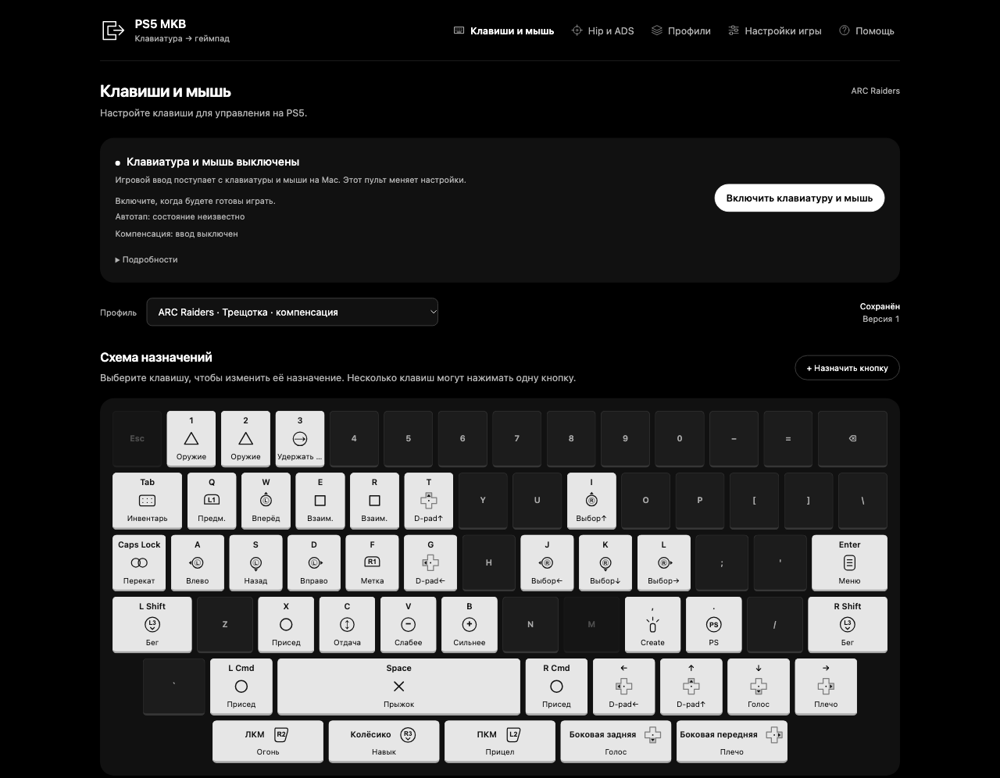

# PS5 MKB

Клавиатура и мышь для PS5 через изменённый клиент [chiaki-ng](https://github.com/streetpea/chiaki-ng). Настройки доступны в браузере: назначения кнопок, чувствительность Hip/ADS и профили.

Я создавал этот проект для **ARC Raiders**, вдохновившись устройством **XIM**. В комплекте моя последняя конфигурация для этой игры: чувствительность мыши, бинды, настройки радиальных меню и профиль «Трещотка» с компенсацией.

Я подробно подбирал настройки и добился очень плавного управления. На моей проводной конфигурации движение мыши ощущалось один в один, без заметной задержки. Это мой опыт в игре, а не инструментальное измерение задержки. Настройки игры и подключения, с которыми я играл, описаны в документации.

Для другой игры можно адаптировать назначения и обработку камеры, но готовый профиль в этом репозитории предназначен для ARC Raiders.

> **Риск блокировки.** Во время использования проекта я получил бан в ARC Raiders. Точная причина блокировки неизвестна. Использование проекта может привести к санкциям в игре; гарантии безопасности аккаунта нет.



## Что потребуется

- Mac с Apple Silicon, клавиатура и USB-мышь или мышь с USB-приёмником. Текущая сборка рассчитана на macOS и arm64.
- PS5 с включённым Remote Play и зарегистрированная в клиенте консоль.
- **Mac и PS5, подключённые Ethernet-кабелями к одному роутеру.** Это критичное условие для стабильной работы и низкой задержки. Проводное соединение не означает полного отсутствия задержки.
- Готовность собрать клиент из исходников и настроить разрешения macOS. Готового установщика пока нет.

## Начать

1. Выполните [установку и первое подключение](docs/setup.md).
2. Запустите `sh scripts/run-dashboard.sh` из каталога проекта.
3. Откройте **http://127.0.0.1:8765** на этом Mac.
4. Подключитесь к PS5 из пульта, затем включите клавиатуру и мышь.

**Esc выключает захват ввода. Cmd + Esc переключает его.** Клавиатура и мышь должны быть подключены к Mac, на котором работает клиент; браузер на другом устройстве только меняет настройки.

## Документация

- [Установка, регистрация PS5 и настройка мыши](docs/setup.md)
- [Как пользоваться: кнопки, чувствительность и профили](docs/usage.md)
- [Что находится на экране](docs/interface.md)
- [Если что-то не работает](docs/troubleshooting.md)

## Что находится в репозитории

| Каталог | Содержимое |
| --- | --- |
| `dashboard/` | Сервер пульта и веб-интерфейс |
| `patches/` | Изменения клиента chiaki-ng |
| `profiles/` | Последний профиль автора для ARC Raiders и резервный профиль |
| `scripts/` | Сборка, настройка, запуск и проверки |
| `tools/` | Локальный перенос настроек официального клиента |
| `tests/` | Автоматические проверки кода и интерфейса |
| `docs/` | Пользовательские инструкции и скриншоты |

Скачанный upstream и сборка создаются в `vendor/` и `build/`; в Git они не входят. Личные настройки хранятся отдельно от исходников.

## Проверка исходников

После подготовки клиента:

```sh
python3 -m unittest discover -s tests -p 'test_dashboard*.py'
sh scripts/test-mkb.sh
npm ci --prefix tests/dashboard-ui --ignore-scripts
node tests/run_dashboard_dom.cjs
```

Node.js нужен только для проверок интерфейса. Эти проверки не подтверждают задержку, поведение конкретной игры или безопасность аккаунта.

Проект основан на chiaki-ng. См. [уведомления и происхождение](NOTICE.md) и [лицензию upstream](COPYING).
