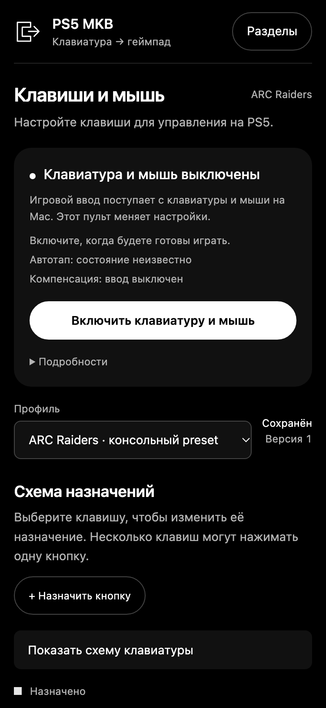

# Что находится на экране

Пульт оформлен в чёрных и серых тонах. Активный раздел выделен в верхней навигации. Статусы сопровождаются текстом: ориентируйтесь на него, а не только на цвет индикатора.

1. **Навигация** открывает назначения, Hip/ADS, профили, настройки игры и помощь.
2. **Управление игрой** показывает соединение и позволяет включать или освобождать ввод.
3. **Выбор профиля** определяет, какую конфигурацию вы редактируете. Рядом показано состояние сохранения и применения.
4. **Схема назначений** открывает редактор по нажатию на клавишу. Ниже находятся действия и назначенные им источники.
5. **Гарнитура DualSense** содержит доступные аудионастройки.

На небольшом экране навигация раскрывается кнопкой «Разделы», а схему клавиатуры можно свернуть.

Скриншоты сделаны на демонстрационных данных. Они показывают расположение элементов, а не реальное подключение к консоли.
