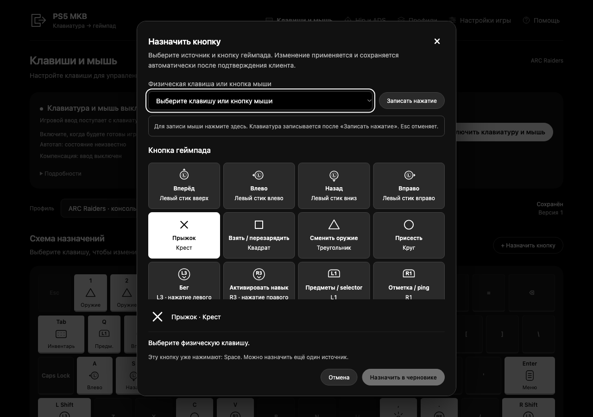

# Как пользоваться

## Подключение и управление

Откройте http://127.0.0.1:8765 на Mac с запущенным сервером. Верхний блок показывает подключение клиента к PS5 и захват ввода. Подключитесь, дождитесь подтверждения и включите клавиатуру и мышь.

- **Esc** выключает захват ввода.
- **Cmd + Esc** включает или выключает его.
- **«Перейти на геймпад»** освобождает клавиатуру и мышь.
- **«Подробности»** показывает состояние службы, клиента и применённого профиля.

Открытый браузер сам по себе не означает, что игровой ввод включён. Проверяйте состояние в верхнем блоке.

## Назначить клавишу или кнопку мыши

1. Выберите нужный профиль в списке над схемой.
2. Нажмите клавишу на схеме или «+ Назначить кнопку».
3. Выберите физическую клавишу из списка. Можно нажать «Записать нажатие», затем нужную клавишу; кнопки мыши записываются в выделенной области окна.
4. Выберите кнопку геймпада и подтвердите назначение. Если клавиша уже занята, интерфейс предложит заменить её назначение.
5. Проверьте новое назначение на схеме и состояние профиля.

Несколько клавиш могут нажимать одну кнопку геймпада. Например, E и R в начальном профиле нажимают Square: взаимодействие или перезарядку выбирает сама игра. Клавиши 1 и 2 нажимают Triangle, а не выбирают два независимых оружейных слота.

Доступны нажатие колёсика и две боковые кнопки мыши. Прокрутка колёсика не поддерживается. На телефоне схема клавиатуры сворачивается; список действий остаётся доступен ниже.

Скриншот использует демонстрационные данные.

## Сохранение и применение

При подключённом клиенте правки применяются и сохраняются автоматически после его подтверждения. Состояние «Применено» означает подтверждение клиента. Сохранение без подключения лишь записывает профиль на Mac и не меняет игру.

Если открыты два окна и возник конфликт, сохраните оба черновика отдельной копией через предложенную кнопку. При неопределённом результате не считайте изменение применённым: проверьте состояние и используйте предлагаемое восстановление управления.

## Hip и ADS

Hip задаёт движение камеры без прицеливания, ADS — во время прицеливания. Меняйте параметры постепенно и проверяйте их в своей игре. Мышь преобразуется в правый стик: ограничения скорости поворота и обработка стика самой игрой сохраняются.

Начальный профиль использует gain 0.015, сглаживание 0 и deadzone 0. DPI и записи калибровки сами по себе не создают измеренную кривую камеры. Измеренной LUT в комплекте нет; точное воспроизведение поведения XIM не заявляется.

## Профили

Во вкладке «Профили» можно задать название, создать копию, импортировать и экспортировать JSON. Перед настройкой другой игры создайте копию начального профиля.

Кнопки восстановления возвращают целый профиль, включая назначения. Перед восстановлением экспортируйте свою конфигурацию. Восстановление сначала выключает ввод; после него включите ввод вручную, когда проверите результат.

## Настройки игры

Этот раздел содержит список значений для сверки на PS5. Пульт не считывает и не меняет настройки игры. Откройте меню игры, сравните значения и отметьте проверку. Рекомендации относятся к ARC Raiders; для другой игры подберите свои значения.

В ARC Raiders автор проверил: D-pad Up переключает фонарик, Left открывает реплики, короткое Right меняет плечо камеры. Отдельное действие удержания Right выдаёт 600 мс удержания; его игровой результат отдельно не подтверждён.

Автотап, компенсация и последовательности нажатий требуют отдельной настройки и проверки. Интерфейс не определяет игровой контекст. Учитывайте [предупреждение о блокировке](../README.md).

## Звук

Блок «Гарнитура DualSense» управляет громкостью соответствующего устройства, когда клиент сообщает поддержку. Громкость общая для приложений, использующих это устройство. Если управление недоступно, проверьте подключение и сборку клиента.
